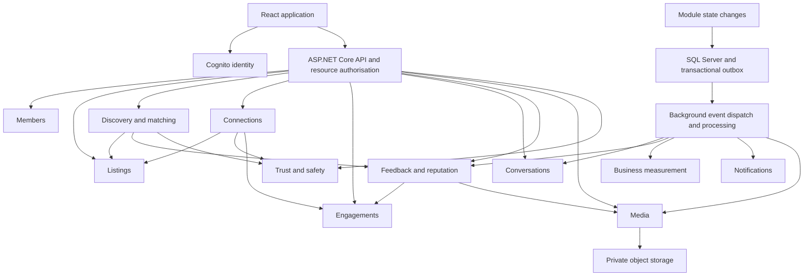
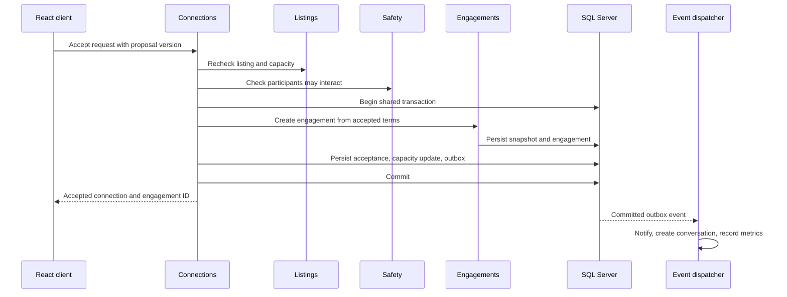

# Connecto architecture and integration

Version 0.1 | 1 October 2026

The proposed architecture is a modular monolith using the existing React client, ASP.NET Core API, and SQL Server. Modules own their business rules and writes. Initially they share a deployment and database, with explicit application interfaces separating them. Media adds private object storage and a background processing capability. No separate microservices are required by this design.

## Target component map



Arrows between modules identify contracts or event delivery, not permission to write the target's tables. All operational modules persist their owned state in SQL Server; the grouped persistence node avoids drawing a line for every module. Background processing is proposed and is absent from the current baseline.

## Existing implementation and proposed structure

The current solution separates Api, Application, Domain, Infrastructure, and Database projects. These are technical layers, not business domains. Preserve the projects and introduce domain-oriented folders/interfaces within them incrementally.

```text
Connecto.Domain/
  Members/ Listings/ Connections/ Engagements/
  Feedback/ Conversations/ Safety/ Media/
Connecto.Application/
  Members/ Listings/ Discovery/ Connections/ Engagements/
  Feedback/ Conversations/ Safety/ Media/ Measurement/
  Contracts/ Integration/
Connecto.Infrastructure/
  Persistence/ Identity/ AI/ ObjectStorage/ Messaging/ BackgroundJobs/
Connecto.Api/
  Controllers/ Authentication/ Authorisation/
```

Keep controllers responsible for transport and authentication context. Application use cases coordinate operations; domain models enforce transitions and invariants. Repository and gateway interfaces belong in Domain/Application as appropriate, with EF Core and vendor implementations in Infrastructure. The current Application services directly reference Infrastructure database interfaces; invert this dependency as modules are touched rather than making a speculative large rewrite. Put HTTP request/response DTOs at application/API boundaries instead of treating them as domain entities.

Start with one EF context and explicit entity mappings, module-owned migrations, and repositories. Separate contexts or SQL schemas are later options if they improve enforcement. Cross-module reads use query contracts or deliberately maintained read models. Avoid exposing EF entities, unrestricted IQueryable, or shared mutable aggregates across module interfaces.

## Data ownership and relationships

| Owner | Proposed records | References and constraints |
|---|---|---|
| Members | MemberProfile, preferences | Unique nullable Cognito subject for existing legacy records; authenticated records require mapping |
| Listings | Need, Offering, Category, Skill, listing skill links, PriceTerms | OwnerMemberId; revision/version; valid money/date ranges |
| Connections | ConnectionRequest, agreed-term proposal | NeedId, OfferingId, participants; uniqueness for active duplicate requests |
| Engagements | Engagement, AgreementSnapshot, CompletionReport, transition history | Unique ConnectionRequestId; immutable participant roles; version for concurrent updates |
| Conversations | Conversation, Participant, Message, Receipt | Unique accepted-connection conversation; unique client message key per sender |
| Feedback | Review, RatingDimension, ReviewAttachment, ReputationSummary | Unique engagement/reviewer; reviewee derived from engagement; role-specific summary |
| Media | MediaAsset, processing metadata | Uploader, parent type/id, purpose, visibility, storage key, processing state |
| Safety | Block, Report, ModerationCase, Restriction, CaseDecision | Resource references; case audit history; minimum relevant evidence |
| Measurement | BusinessEvent, metric projections | Unique source event ID; cohort timestamps and pseudonymous member references |
| Integration | OutboxMessage, consumer receipt, notification delivery | Unique event/consumer receipt; retry and delivery state |

Use IDs across boundaries. Navigation properties within a module are acceptable; a Member aggregate must not load and mutate all listings or reviews. Preserve accepted terms even after listing updates or closure. Define account erasure and retention behaviour before applying destructive cascades to engagements, reviews, messages, or cases. Existing Match mapping does not establish a working persisted acceptance lifecycle.

## Application contracts

| Contract | Owner | Responsibility |
|---|---|---|
| GetMemberPublicProfile / UpdateOwnProfile | Members | Safe profile views and owner updates |
| GetPublishedListing / ValidateConnectionEligibility | Listings | Current listing visibility, ownership, capacity, revision and terms |
| SearchOfferings / RecommendForNeed | Discovery | Eligible ranked read results with scoring version and reasons |
| RequestConnection / AcceptConnection | Connections | Participant commands; explicit mutually agreed terms |
| CreateFromAcceptedConnection | Engagements | Idempotent creation using accepted snapshot |
| SubmitCompletionReport / GetReviewEligibility | Engagements | Independent reports and eligibility read decision |
| SendMessage / GetConversation | Conversations | Participant-authorised communication |
| SubmitReview / GetReputationSummary | Feedback | Review rules and derived public reputation |
| RequestUpload / FinaliseUpload / AuthoriseAssetRead | Media | Parent-authorised upload and retrieval |
| CheckInteractionAllowed / SubmitReport / ResolveCase | Safety | Blocks/restrictions and audited decisions |

Authorise the resource before exposing it. API checks are backed by application checks so jobs and internal calls cannot bypass invariants. Moderators have narrowly scoped permissions and audit trails. Contracts return purpose-specific DTOs, never raw storage keys, private evidence, or another participant's unpublished review.

## Events and reliable integration

Use synchronous contracts for validation and commands requiring an immediate result. Use durable integration events for projections, notifications, and secondary resources. Write an outbox event in the same SQL transaction as its source state change. A dispatcher retries delivery; each consumer deduplicates by event ID. This provides at-least-once processing rather than an assumed exactly-once transport.

| Event | Producer | Consumers and effect |
|---|---|---|
| ListingPublished / ListingChanged / ListingClosed | Listings | Refresh discovery reads; measure publication |
| RecommendationsViewed / OfferingMarkedSuitable | Discovery | Record distinct business milestones |
| ConnectionRequested | Connections | Notify recipient; measure request |
| ConnectionAccepted | Connections | Create conversation; measure mutual agreement |
| EngagementStarted | Engagements | Notify participants; measure progress |
| CompletionReported | Engagements | Notify other party; update outcome projections |
| CompletionDisputed | Engagements | Open Safety case idempotently; measure dispute |
| CompletionConfirmedByBoth | Engagements | Open Feedback eligibility; notify; measure completion |
| ReviewSubmitted / ReviewPublished / ReviewExcluded | Feedback | Measure participation; recalculate reputation only when eligible |
| ReputationUpdated | Feedback | Refresh discovery/profile read models |
| MediaReady / MediaRejected | Media | Update review publication readiness; inform uploader |
| ModerationDecisionRecorded | Safety | Apply target-specific review/media/interaction changes; audit |

Events include EventId, type/version, aggregate ID/version, occurred-at UTC, and correlation ID. Carry minimal identifiers and outcome fields; omit passwords, tokens, messages, image bytes, private case evidence, and review text from general integration events. Consumers handle per-aggregate ordering/version checks where required. Retries are bounded with failed-event visibility and a recovery workflow. Scheduled review publication rechecks current eligibility, window expiry, attachment readiness, and moderation state.

## Connected workflows

### Acceptance and engagement creation



The acceptance use case coordinates this shared transaction through module contracts. Listings atomically claims Need capacity under the proposed single-engagement rule; a uniqueness constraint/conditional update prevents two concurrent acceptances from claiming it. Engagement creation has a unique ConnectionRequestId. Use optimistic concurrency for term revisions and explicit conflict responses. Listing closure, restrictions, and acceptance must use compatible locking/version checks at the authoritative write; earlier reads alone do not prevent races. If conversation creation fails, retry its event without losing the accepted engagement.

### Completion and feedback

Each participant submits their own completion report. Engagements updates derived confirmation and records its event atomically. A disagreement opens a Safety case. When both confirm, Feedback creates two review opportunities using the engagement roles and an eligibility timestamp. Reviews remain hidden until both are submitted or the window expires. Publication requires attachments to be ready and applicable restrictions to be checked. Published reviews update role-specific summaries; moderation exclusion reverses their contribution through idempotent recalculation.

Completion closure is distinct from review submission. Feedback delay must not prevent a completed engagement from being recorded. A resolved dispute changes the authoritative outcome through an audited engagement operation; Safety never directly overwrites completion reports. Reviews need a defined invalidation policy if outcome eligibility is subsequently reversed.

### Image upload and review publication

1. The participant requests an upload for their draft review or authorised case.
2. Media validates parent ownership, purpose, allowed visibility, count and size limits; creates a pending asset and short-lived upload grant.
3. The browser uploads to a private quarantine location in object storage.
4. Server-side processing checks actual file format and decoding, dimensions and size, removes sensitive metadata, creates safe display variants, and applies configured content checks.
5. Media marks the asset ready or rejected. A client declaration alone cannot mark it ready.
6. Feedback links only assets owned by that reviewer with the matching parent and approved visibility. Publication waits for readiness or allows the user to remove a rejected attachment.
7. Retrieval rechecks parent access and returns a short-lived authorised URL or streams the allowed variant. Private evidence never uses a public bucket URL.

Proposed storage provider: private S3, consistent with the existing AWS environment. Processing jobs and bucket/IAM resources require implementation. Object deletion is asynchronous and idempotent: remove public access first, then delete variants/originals under the retention policy. Cleanup orphaned pending uploads. Withdrawal, hidden reviews, and moderation changes must also invalidate access; use short URL lifetimes and avoid long-lived cached access to private evidence.

## Runtime and operations

Retain the existing ECS/API, RDS SQL Server, Cognito and migration-runner deployment approach. Add object storage and a background worker only when their features are introduced. A worker may share application libraries but runs with separately scoped object-storage and processing permissions. Notifications initially surface in-app; external delivery channels are later choices.

Continue migration-before-API deployment with additive changes. Monitor request failures, database readiness, outbox lag, failed jobs, image processing failures, and state conflicts using correlation IDs. Do not log tokens or private content. Make optional AI parsing independently configurable so a parsing outage does not prevent posting structured listings. Production retention, restore objectives, message delivery targets, upload limits, and response targets remain decisions to define and verify.
