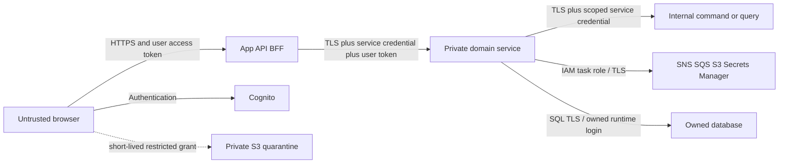

# Connecto proposal validation, security and repository structure

Version 0.1 | 1 October 2026 | Proposed controls and repository names

## Validation outcome

The microservices proposal is coherent as a future target; it is not ready for simultaneous extraction of all domains. Preserve ten business ownership boundaries, deliver missing capabilities inside the current API, and split deployments only with demonstrable operational or ownership benefit. Repository separation is also staged. No remote repositories, product changes, infrastructure or security tests were created by this review.

| Finding | Assessment and required change |
|---|---|
| Domain alignment | Members, Listings, Discovery, Connections, Engagements, Conversations, Feedback/Reputation, Media, Safety and Measurement match business-boundaries.md. Needs/Offerings and Feedback/Reputation should remain paired. Cognito is identity infrastructure, not a new password microservice. |
| Initial footprint | Ten business services plus Notifications, optional Parsing and the BFF would produce up to fourteen application deployables. This is a target inventory, not the first-release deployment count. Keep core write modules together initially. |
| Acceptance failure windows | The reservation/preparation/activation coordinator is appropriate, but activation before final acceptance must not enable participant actions. microservices.md 0.2 adds AcceptanceFinalised acknowledgement, pending usability, retry and provenance rules. |
| Restrictions and listing races | No global transaction protects concurrent blocks, listing revisions and acceptance. Explicitly define consistency semantics; verify Offering revision as well as Need capacity; expiry/fencing cannot substitute for authorisation. Strict atomic policy is a core-extraction blocker. |
| Projections | Eventual consistency is suitable for ranking and measurement. Authoritative visibility/permission checks are required for private content and new protected actions. A stale public projection containing withdrawn/private content is a leak, not merely a freshness warning. |
| Identity resolution | CurrentUser provisions in the shared EF context. Extraction must move provisioning exclusively to Members and provide a narrow authenticated subject-resolution contract. Other services must not create their own subject-to-member mapping. |
| App migration | Feature clients and server-backed state address the existing broad hook/local storage. Preserve current tokens in memory; do not introduce persistent browser token storage through a cache refactor. |
| AWS compatibility | ECS/RDS/Cognito are compatible starting points. HTTPS, workload credentials, owned DB grants, messaging policies and recovery operations need implementation. AWS resource state, workload cost and capacity were not verified. |

## Observed current security posture

These observations are limited to inspected source, not a penetration test or statement about live deployment.

| Evidence | Present control or gap | Required disposition |
|---|---|---|
| CognitoAuthentication.cs | Signed RS256 tokens, trusted issuer, expiry, access token_use, configured client_id and subject are checked; fallback policy requires authentication. ValidateAudience=false is deliberate for this access-token configuration, not evidence of unauthenticated acceptance. | Preserve these checks; explicitly validate any configured resource audience when adopting resource-bound tokens; separate machine tokens and user tokens. |
| NeedsController/OfferingsController and OwnershipAuthorization.cs | Posting derives owner from current identity; match access checks ownership. Existing handler covers only Need and Offering. | Extend resource-specific policies to connection participants, messages, reviews, media and staff cases as those domains appear. |
| UserController.cs | /users/me returns private self-profile fields. This is not a public-profile leak by itself. | Define a separate public DTO rather than reusing the self-profile DTO for Discovery/BFF composition. |
| cognito.js | Access and refresh tokens are held in closure memory; logout only clears local session. Additional Cognito challenges are unsupported. | Keep tokens out of local storage/logs; implement supported challenge handling; define remote revoke/global sign-out and local cache clearing. JWT validation alone does not instantly detect remote revocation. |
| cognito.js versus terraform/cognito.tf | App uses USER_PASSWORD_AUTH; declared client enables SRP and refresh, not password auth. No custom API resource scopes are declared. | Reconcile via Cognito managed login/authorization code with PKCE or supported SRP, or explicitly adopt password auth as a reviewed POC choice. Do not assume custom user scopes already exist. |
| terraform/alb.tf/security.tf | Public listener and target group are HTTP; HTTPS redirect in API is not an ALB certificate/listener. Security groups allow broad outbound traffic. | Configure HTTPS public listener/certificate and redirect-only HTTP, protected downstream encryption, trusted proxy settings, and scoped service/network paths. Live config may differ. |
| Program.cs | No rate-limit, CORS or forwarded-header registration in inspected startup. | Same-origin production routing avoids needing broad CORS; any cross-origin mode needs exact allowlist. Add command/resource quotas and trusted-proxy handling. Edge controls may exist externally but were not inspected. |
| DatabaseConfiguration.cs and continuation.md | Deployed connection builder enables encryption and certificate validation; continuation records master-account POC credentials. Local DefaultConnection passes through. | Preserve verified SQL TLS; separate migration/admin credentials from per-domain runtime logins; verify local/production trust config and no cross-database grants. |

## Security boundaries

Every arrow crosses a trust boundary. A BFF for composition is not automatically a cookie-based authentication BFF; retain bearer mode initially. A later server-session BFF requires a separate design for HttpOnly/Secure/SameSite cookies, CSRF tokens and Origin checks, session rotation, server-side refresh tokens and logout. Do not mix these modes accidentally.

## App-to-services concerns and proposed controls

| Concern | Control and enforcement location | Required negative evidence |
|---|---|---|
| Token theft, forgery and wrong identity | HTTPS throughout public transport; tokens in memory; no browser secrets; edge and protected services verify trusted issuer/JWKS, algorithm, lifetime, token_use and client_id. Use ID tokens only for their identity purpose, never as API access credentials. If resource audience is configured, validate it too. | Modified, expired, wrong-pool/client, ID and missing tokens fail without data/state exposure. |
| Object and function access | Domain service derives member from trusted subject and checks ownership/participants/current restrictions on each action. Staff APIs require explicit role/scope and auditable case purpose; staff MFA/challenge support is a release gate. | Member A cannot read/mutate member B's Need, message, hidden review, acceptance operation or media. Member tokens cannot invoke staff/internal commands. |
| XSS, browser cache and content injection | Render user text safely, avoid raw HTML; restrictive CSP and dependency review; private HTTP responses use no-store; member-scoped client caches are cleared on logout/account switch. Public/publicly cacheable DTOs exclude private fields. | Malicious listing/review/message content is inert; account switching and browser-back do not expose the previous member's private cached content. |
| CSRF and origin confusion | Bearer mode uses explicit Authorization headers rather than ambient cookies; exact CORS allowlist where needed. CORS is not API authentication. Cookie mode, if adopted, adds anti-CSRF and Origin validation; XSS remains a separate risk. | Foreign origins cannot use ambient credentials to mutate state; unauthorised direct HTTP clients are still rejected. |
| Excessive requests, scraping and paid parsing abuse | Edge and domain quotas by actor/resource, bounded pagination/filter complexity, body/upload limits, parse concurrency/cost budgets, timeouts and 429 handling. Protect signup/login against automated abuse. | Oversized bodies and abusive repeated commands/uploads/AI requests are bounded; retries cannot multiply agreements or reviews. |
| Upload leakage and malicious files | Media authorises parent ownership/purpose; exact generated key, short expiry and enforceable upload-size/type constraints; private quarantine, decoder validation, malware/content controls, metadata stripping and safe variants. Served URLs remain short-lived bearer capabilities. | Swapped parent/key/visibility, oversized or malformed files fail; pending/rejected/hidden/private evidence cannot be served publicly. |
| Stale visibility and revoked access | Authoritative parent-state check on private reads and media grants. Withdrawn content removes public access and invalidates projections/caches. Short-lived grants bound residual access; immediate revocation requires proxy delivery or another revocable mechanism. | Hidden reviews or withdrawn media do not leak through BFF/search/CDN; grant replay after expiry fails. Do not assert issued URLs revoke instantly. |
| Manipulated fields or retry keys | Explicit DTO allowlists; derive roles/reviewee/status server-side; expected revisions; idempotency scope includes actor, action and resource with payload hash and retention policy. | Client cannot set reputation, reviewer identity, accepted state or moderation status; another actor cannot read/reuse an operation result. |
| SSRF and data exfiltration | BFF uses configured service destinations; no client-supplied proxy target. Do not fetch arbitrary attachment URLs; allowlist parser/vendor egress and minimise sent listing data. | Requests cannot reach metadata endpoints/internal admin services via URLs or redirect chains; AI output never executes commands or publishes directly. |

## Services-to-services identity and authorisation

Recommended first extracted-service implementation: encrypted private transport plus per-caller OAuth machine credentials using Cognito client-credentials resource scopes. Use a distinct confidential app client per workload and environment, with secrets in Secrets Manager and rotation. This requires provisioning resource servers/app clients and validating support/cost; it is not present in current Terraform. AWS task-role IAM authorises AWS API calls, not arbitrary ASP.NET HTTP endpoints. Avoid a shared API key or one global machine client.

Define an internal authentication scheme separate from the current human-access-token scheme. Validate machine-token signature/issuer/expiry, token_use, permitted client_id-to-workload mapping, exact required target scope and configured audience where present. A machine-token subject is not a member; never send it through CurrentUser auto-provisioning. Example scopes are connecto-listings/reserve-capacity and connecto-engagements/prepare; allocate only necessary target/action scopes to each caller.

For an immediate command on behalf of a member, require **both** caller-service identity and a separately validated human access token. Proposed wire contract: Authorization holds the machine token; a designated internal user-token header carries the original Cognito user token. Edge routes strip all client-supplied internal identity headers and construct the internal request themselves. Services use separate validation handlers, never log either credential, derive the member through Members, and independently check resource access. This is token forwarding, not an OAuth token-exchange claim; forwarded human tokens remain replayable until expiry. Minimise recipients and lifetime. An audience-bound delegation/token-exchange system is a later alternative requiring explicit implementation.

Durable workers do not store or replay expired human tokens. An authorised domain command stores initiator, operation ID, exact authorised intent and resource/terms revisions. Subsequent saga steps use scoped workload authority plus authoritative operation/reservation provenance and renewed Safety checks. A forged MemberId in a job/event is insufficient authority. Internal commands bind operation, initiator, participants, terms hash/revisions and fencing generation; Engagements verifies Listings' committed reservation before enabling the operation, and Connections verifies acknowledgements before final acceptance.

| Caller → receiver | Permitted purpose | Authority boundary |
|---|---|---|
| BFF → Members/Listings/Discovery | Self profile, public views, listing commands and recommendations | Edge workload scope plus human token for protected member operations; public-view route still uses safe DTO |
| BFF → Connections/Engagements/Conversations/Feedback | Participant commands and reads | Human participant checks plus specific edge scope; no internal prepare/activate/case-resolution routes |
| Connections → Listings | Reserve, commit, query/release capacity for its recorded acceptance | Acceptance operation provenance and fence; caller-specific scope; no general listing edit privileges |
| Connections → Engagements | Prepare/activate/query/finalise its recorded agreement | Unique request/operation and verified reservation; no scope to submit a member completion report |
| Operational services → Safety | Permission decision for specified actors/action/resource | Narrow check scope; decision revision/time; no broad private case/evidence access |
| Safety → Engagements/Feedback/Media | Audited resolution or exclusion via target-owned command | Case decision ID and version, staff action audit; no direct database writes |
| Media → Feedback/Safety | Validate parent and access decision | Purpose-specific permission response; avoid arbitrary payload fetch and circular synchronous calls |
| Worker → domain internals | Only its designated recovery/publication/processing commands | Workload scope and persisted operation/job provenance; no impersonation or unrestricted admin role |

For Media/Feedback calls, choose a one-way authorisation contract: parent validates and issues a bounded attachment intent, Media records/processes it, and parent links only matching ready assets. Do not have synchronous Media→Feedback→Media validation loops. Private download revalidates parent permission without requiring the parent to download asset bytes.

Service Connect TLS is proposed transport encryption, **not** the API action authorisation layer. AWS documents that only traffic passing through its agents is encrypted. Protect ALB→BFF and any bypass paths separately; do not call this automatic end-to-end encryption or assume mutual client authentication solves permissions. Restrict security-group ingress to expected callers/ports; scope egress and prevent direct browser access to internal commands. Scope access to Service Connect certificate secrets; do not give all task roles access to those keys.

## Events, data and delivery security

SNS/SQS producers and consumers use separate scoped IAM task roles, topic/queue policies and TLS; require approved publisher/topic subscription paths, validate envelope/schema/type and reject unsupported inputs. General events contain minimal IDs/outcomes, not user tokens, private messages or hidden review content. Consumer authorisation and operation provenance are still needed for state-changing events; a valid queue message is not arbitrary command permission. Audit DLQ access/replay as privileged operations, bound payloads and retain deduplication/version state through replay. Do not grant Measurement or Notifications a wildcard ability to publish authoritative acceptance/moderation events.

Each service has a runtime SQL login constrained to its own database and a separate migration identity. Encrypt SQL, verify certificates, encrypt stores/backups, and test restore/deletion policy. Secrets, JWTs, upload grants and private content are redacted from logs/traces. Correlation IDs are opaque; staff evidence reads, restrictions and decisions require audit records with purpose, actor and resource. Limit database/secret/topic/queue access independently of repository membership.

CI deployments use GitHub OIDC with repository/environment-bound AWS trust, protected production environments, reviewed changes and immutable image digests. Separate service deployment rights from platform/IAM/migration privileges; do not replicate a broad legacy deploy role into every repository. Scan dependencies/images and test negative authorisation/contract cases. Restoration, secret rotation and certificate expiry must have operational evidence, not just configuration.

## Repository names and ownership

Use lowercase connecto- prefixes; preserve existing connecto-app and connecto-api names. A repository can initially contain several domain modules. The table is a recommended destination catalogue; none are created remotely by this request.

| Repository | Purpose | Creation recommendation |
|---|---|---|
| connecto-app | Existing React web app, feature clients, UI journeys and app tests | Keep existing; one app spans all member roles/domains |
| connecto-api | Existing API; temporary modular core and legacy compatibility during migration | Keep existing; retire only after verified cutovers; no mass rename |
| connecto-app-api | App API/BFF, explicit public DTO composition and compatibility routing | Create when edge extraction is justified; initial edge routes may live in connecto-api |
| connecto-members-service | Member profile and subject mapping | Extract from core when ownership/auth migration is ready |
| connecto-listings-service | Needs, Offerings, taxonomy, revisions and capacity | Extract after reservation/provenance rules and single-writer cutover are verified |
| connecto-discovery-service | Search/recommendation projections and scoring | Early domain extraction candidate after complete listing events exist |
| connecto-connections-service | Requests, decisions and durable acceptance coordinator | Later extraction; initially module in connecto-api |
| connecto-engagements-service | Agreement snapshots, progress, completion and history | Later extraction alongside validated acceptance recovery |
| connecto-conversations-service | Participant chat, history and receipts | Create when persistent chat ships and operational ownership warrants it |
| connecto-feedback-service | Reciprocal feedback plus role-based reputation | Keep reputation within this repository/service |
| connecto-media-service | Media API, metadata, upload grants and processor worker | First supporting extraction candidate when uploads ship; API/worker may be separate images in one repo |
| connecto-trust-safety-service | Blocks, restrictions, cases, staff authorisation and decisions | Start as module; extract only with live policy/operations ownership |
| connecto-measurement-service | Journey measurement and internal cohort reporting | Extract as read-oriented consumer when event evidence exists |
| connecto-notifications-service | In-app notifications, preferences/delivery attempts | Supporting extraction candidate; no business-state decisions |
| connecto-listing-parser-service | Optional vendor parsing adapter/API or worker | Optional; keep adapter in core until isolation adds value; no approval/publishing authority |
| connecto-platform | Shared AWS/IaC, environment wiring, OIDC trust and narrowly scoped deployment templates | Move existing Terraform by reviewed state-preserving migration; service-specific config follows documented ownership |
| connecto-docs | Domain design, canonical Word documents, history and change register | Optional later move; keep current docs paths until explicit document-location/process approval |

Recommended near-term set: retain connecto-app and connecto-api; introduce connecto-platform when infrastructure ownership is established; add connecto-app-api, connecto-media-service and connecto-notifications-service at their extraction gates. Do not create empty service repositories. The complete target has ten domain repositories, two supporting repositories if Parsing is extracted, one BFF and one app: fourteen application repositories after connecto-api is retired, plus platform and optional docs. Before retirement, the legacy repository increases the total by one.

Do not create separate Needs, Offerings, Rating, Completion, Authentication, Payments or message-transport repositories in this scope. No separate admin app is required yet; staff routes/components may live in connecto-app with server-enforced permissions and suitable authentication. A future staff console can be connecto-admin-app if operator workflows require independent delivery.

Each .NET service repo should contain src/<Service>.Api, .Application, .Domain, .Infrastructure, a service-owned migration runner and optional worker, tests, OpenAPI/events, Dockerfiles and release workflow. HTTP DTOs/events are contracts, not shared EF entities. Producer repos own and version their schemas; consumers use pinned generated clients and compatibility tests. Avoid a shared connecto-domain library. Create a contracts/platform library only for demonstrated stable cross-cutting needs, without shared business writes or lockstep releases.

## Release validation gates

Required evidence before extracted services receive production traffic: token-negative and resource-access tests; service-scope/caller-negative tests; no human/machine identity confusion; bounded replay and idempotency; reservation/activation/finalisation failure injection; concurrent restriction/revision tests; private-content cache/media tests; DB/IAM isolation; public/internal TLS path inspection; rotation/revocation/logout behaviour; authentication-flow reconciliation; deployment/restore drill. Exact SLOs, token lifetimes and retention periods remain product/operations decisions. This review did not execute those tests.

## Source references

Local sources: microservices.md v0.2; business-boundaries.md v0.1; connecto-api/Connecto.Api/Authentication/{CognitoAuthentication,CurrentUser,OwnershipAuthorization}.cs; Controllers/{User,Needs,Offerings,ListingParse}Controller.cs; Program.cs; terraform/{alb,security,cognito}.tf; DatabaseConfiguration.cs; connecto-app/src/services/{auth,cognito,api}.js; continuation.md.

- [Cognito JWT validation](https://docs.aws.amazon.com/cognito/latest/developerguide/amazon-cognito-user-pools-using-tokens-verifying-a-jwt.html): trusted issuer/signature/lifetime and Cognito token-purpose/client checks.
- [Cognito scopes and machine clients](https://docs.aws.amazon.com/cognito/latest/developerguide/cognito-user-pools-define-resource-servers.html): resource scopes and client-credentials support; the proposed internal credential design still requires implementation.
- [ECS Service Connect TLS](https://docs.aws.amazon.com/AmazonECS/latest/developerguide/service-connect-tls.html): agent-path encryption, rotation and certificate-secret access considerations.
- [OWASP authorisation guidance](https://cheatsheetseries.owasp.org/cheatsheets/Authorization_Cheat_Sheet.html): deny-by-default, least privilege and checks on every resource operation.

Canonical documentation revision proposal: DCR-2026-10-01-003, pending human approval, superseding DCR-2026-10-01-001. The separate off-platform risk proposal 002 remains pending and should be reconciled before canonical application.
