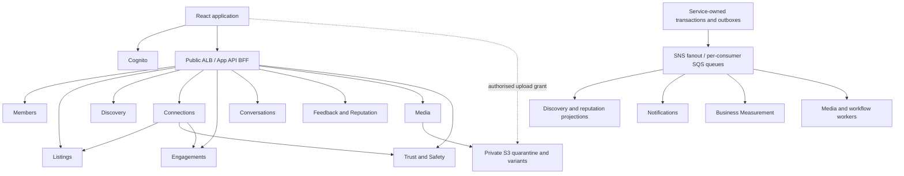

# Connecto microservices and app integration design

Version 0.2 | 1 October 2026 | Validated design review; proposed target, pending architecture adoption

## Recommendation and baseline

Keep one React application and one public API entry point. Organise backend ownership around the ten domains in business-boundaries.md, with separate deployable services as the target. Introduce those boundaries inside the existing API first, then extract services in stages. Do not launch twelve services before their business capabilities exist.

This proposal supplements the 0.1 domain design. It changes the proposed deployment direction from a modular monolith to staged microservices; it does not silently replace architecture.md or establish approved product policies. Independent completion reports, reciprocal feedback and optional outcome photos remain the agreed direction. Capacity, review windows, cancellation, retention and moderation policies remain proposals requiring decisions before release. Payments and delivery logistics remain outside scope.

Validation result: suitable as a staged architectural target, with implementation gates. This is a source/contract/threat review, not runtime security certification. Detailed findings, security controls and repository recommendations are in [validation, security and repositories](microservices-validation-security-repositories.md). Version 0.2 clarifies identity, final acceptance visibility and projection security; it does not mark the design approved.

Evidence reviewed: business-boundaries.md, architecture.md, implementation.md; connecto-app/src/hooks/useConnecto.js and src/services/api.js; API Program.cs, MatchesController, DiscoverController, and ConnectoDbContext; terraform/ecs.tf; continuation.md. Live AWS state was not inspected.

Current backend projects are technical layers, not separate services. A single ASP.NET Core host composes application services, EF Core and AI parsing. One context owns Users, Needs, Offerings, skill links and Match mapping. Match mapping is not an implemented connection/engagement lifecycle. Frontend persistence uses local storage for profiles, listings and messages; authenticated profile retrieval, listing creation and Need matching have API integration. Discover and match-preview controllers are placeholders. API matches may lack offering details, causing placeholder cards. OpenAI configuration is currently required at API startup.

## Service boundaries

Each row is a target service with its own API, application/domain rules, persistence adapter, migration ownership and release pipeline. A service can contain several aggregates; an aggregate does not require a deployment.

| Service | Owned data and commands | Integration |
|---|---|---|
| Members | MemberProfile, private preferences, Cognito-subject mapping; provision member, update own profile, safe public profile | Cognito supplies authentication; publish MemberProfileChanged and lifecycle events; consume restrictions for display without becoming permission authority |
| Listings | Needs, Offerings, taxonomy, price basis/currency, publication revisions, Need capacity reservations | Publish listing changes; expose authoritative validation and reserve/commit/release capacity commands; consume identity references |
| Discovery | Search projections, candidate eligibility, ranking configuration/version, explanations, suitability actions | Consume Listings, published Reputation and permitted Safety projections; fetch authoritative checks for sensitive actions; never write Listings |
| Connections | Requests, proposed terms and versions, recipient decisions, acceptance workflow state | Coordinate Listings/Safety/Engagements; publish ConnectionRequested and ConnectionAccepted only after defined milestones |
| Engagements | Immutable accepted-term snapshots, roles, work progress, cancellation, independent completion reports and history | Idempotent creation by ConnectionRequestId; publish completion events; apply audited case resolutions through its own commands |
| Conversations | Participants, messages, client retry keys and receipts | Create conversation idempotently on acceptance; enforce current participant/restriction checks; polling first, live transport later |
| Feedback and Reputation | Reviews, role-specific dimensions, hidden/public states, attachment references, derived role summaries | Consume completion eligibility, Media readiness and Safety exclusions; publish ReviewPublished/ReputationUpdated; retain these together initially |
| Media | Asset metadata, upload grants, quarantine/processing states, variants and deletion jobs | Private S3 plus processor; parent-resource authority grants access; no public URLs for hidden reviews/private evidence |
| Trust and Safety | Blocks, restrictions, reports, cases, evidence permissions, moderation/dispute decisions | Authoritative interaction permission checks; publish restriction revisions/decisions; domain owners apply changes to their own records |
| Business Measurement | Deduplicated journey events, metric definitions, cohorts and reporting projections | Consume operational events; staff reporting endpoint; never change outcomes or reputation |

Supporting services: Notifications owns in-app notifications and delivery attempts, consuming recorded events; optional AI Parsing returns listing proposals for Listings to validate after member confirmation. Parsing may remain an isolated adapter/worker until independent scaling or deployment is useful. Cognito remains managed identity, not a custom password service. The App API/BFF is an edge composition service, not another business domain.

Keep Needs and Offerings together for taxonomy and capacity rules. Keep Feedback and Reputation together for review eligibility/publication and deterministic recomputation. Keep Connections and Engagements as distinct modules within the same deployment until acceptance recovery is proven. All ten domain boundaries apply even while deployments are grouped.

## App and service topology

The event node represents publishing from every domain, not a shared operational database. Browser traffic goes to one stable HTTPS origin; services remain private. Direct S3 upload is the exception and uses a restricted, short-lived grant. The BFF routes commands and composes screen-specific read DTOs. Acceptance and review rules stay in domain services. Avoid making every screen depend synchronously on every service.

Retain Cognito bearer-token authentication initially. Validate token signature, issuer, audience/client and token-use according to the configured Cognito integration at the edge and protected service boundaries. Never trust a browser-supplied MemberId. Members owns unique subject mapping; propagate authenticated context through verifiable credentials, not unsigned identity headers. Authenticate workers/services separately with scoped permissions. Services enforce ownership, participant and staff authorisation independently of routing. Network privacy alone does not authorise a request.

Public profiles omit email, street address, subject and preferences. Hidden reviews and private evidence never enter general-purpose discovery/activity projections. Safety checks fail closed for new protected interaction commands when the authority is unavailable; reads may serve labelled stale public projections if their visibility policy permits it.

## Proposed app contracts and screen ownership

These are new contracts, not claims that routes already exist. Preserve existing /api/users/me, listing POST routes and /api/needs/{id}/matches through edge compatibility adapters during migration. Version new contracts under /api/v1; remove compatibility only after client migration.

| App feature | Public contract examples | Authority and behaviour |
|---|---|---|
| Profile | GET/PATCH /api/v1/me; GET /api/v1/members/{id} | Members; Reputation summary can be composed separately; real edits survive devices |
| Listing forms and management | POST /needs, /offerings; GET/PATCH /needs/{id}; POST /needs/{id}/publish; equivalent offering routes under /api/v1 | Listings; explicit currency/basis, taxonomy and revision; parsing returns editable proposal |
| Discover and matches | GET /api/v1/discovery/offerings; GET /api/v1/needs/{id}/recommendations | Discovery plus safe listing/member/reputation projections; cursor pagination, scoring version, reasons, projection timestamp |
| Offering detail | GET /api/v1/offerings/{id} | Listings, composed with public profile/reputation; authoritative availability before connection |
| Connection request | POST /api/v1/connections; POST /connections/{id}/accept, /decline, /withdraw | Connections; idempotency key and expected terms version; body identifies listing pair, server derives roles |
| Activity and agreement | GET /api/v1/me/activity; GET /engagements/{id}; POST /engagements/{id}/completion-reports | Activity read model plus Engagements; show accepted terms and each confirmation distinctly |
| Inbox and chat | GET /api/v1/conversations; GET/POST /conversations/{id}/messages | Conversations; cursor history, stable client message key, explicit read/delivery semantics |
| Reviews | GET /api/v1/engagements/{id}/review-eligibility; POST /engagements/{id}/reviews; GET /members/{id}/reputation | Engagements and Feedback via BFF; hidden submitted state, publication state, role counts, insufficient-history state |
| Photos | POST /api/v1/media/upload-grants; POST /media/{id}/finalise; GET /media/{id}/access | Media with parent authority; processing state; attachment visibility chosen explicitly |
| Reporting/blocking | POST /api/v1/reports; POST/DELETE /blocks/{memberId} | Safety; cases visible only under case permissions |
| Notifications | GET /api/v1/me/notifications; POST /notifications/{id}/read | Notifications; durable server-backed delivery state |

Paths abbreviated in rows inherit /api/v1. Separate staff case and measurement routes require staff scopes. Command errors use safe structured ProblemDetails, a correlation ID and distinguish 401/403/404, validation failures, 409 concurrency conflicts, 202 pending workflows and 503 dependencies. Do not return stack traces. Use expected aggregate revisions and scoped idempotency keys with payload hashes; a reused key with different content conflicts. Do not blindly retry non-idempotent POSTs after timeout.

Refactor src/services/api.js into an HTTP transport supporting explicit methods, cancellation, structured errors, idempotency and revisions, plus clients by domain. Replace the broad useConnecto hook with feature hooks/server-state queries: Members, Listings, Discovery, Connections, Engagements, Conversations, Reviews, Media and Safety. Keep ephemeral presentation state local. Introduce addressable routes so listing, conversation and engagement IDs survive refresh and deep linking. Any new routing/server-query package is an implementation decision, not a required vendor choice.

Replace production local-storage authority with authenticated server reads and cache invalidation. Isolate demo storage and fake profiles/ratings from real records and measurements. Clear member-scoped caches on logout/account change; never migrate demo messages into production implicitly. Refresh data after mutations/events and represent loading, empty, stale, failed and pending states. Remove default neighbourhood assumptions from production forms. Fetch complete offering summaries instead of synthesising API match cards. Do not present a match as a connection or a conversation as an agreement.

Add connection requests and accepted/pending activity, agreement detail, separate completion-report controls, reciprocal review flow, media processing feedback and report/block actions. A one-confirmed or disputed engagement must remain visibly distinct from both-confirmed. Start chat with authorised polling; introduce SSE/WebSocket only when needed, with reconnect and persisted-history reconciliation.

## Acceptance across independent services

The monolith's shared acceptance transaction cannot be carried into database-per-service deployment. Connections owns a persisted acceptance coordinator (saga), not the BFF. Proposed workflow:

1. Authenticate the recipient, validate requested terms revision and store an idempotent AcceptancePending operation.
2. Obtain a current Safety permission decision/revision and ask Listings to reserve the Need capacity and validate the exact Need/Offering revisions. Listings atomically enforces the proposed capacity rule and returns a reservation token, expiry and fencing generation.
3. Engagements creates an inert Prepared engagement uniquely keyed by ConnectionRequestId and operation ID, from the accepted snapshot. Prepared records cannot receive messages, completion reports or reviews.
4. Commit Listings' reservation using the token/generation and recheck publication and relevant restriction permission. A failed/expired commit aborts the prepared engagement and releases any live reservation. A committed reservation does not expire automatically.
5. Activate the prepared engagement idempotently after confirmed reservation commitment. Persist the accepted connection and its outbox event once activation is confirmed. Return the stable connection/engagement IDs. Earlier responses are 202 with an operation URL; the app polls until success/failure.
6. After commitment, prefer retry/reconciliation to releasing capacity when activation or response delivery fails. Never release committed capacity merely because an HTTP response timed out. A recovery worker queries authoritative operation states and retries missing steps. Unrecoverable inconsistencies become a visible operational case, with explicit compensation commands that preserve history.

An activated engagement can exist before Connections durably records final acceptance. Keep participant mutations gated on a separate AcceptanceFinalised acknowledgement delivered from Connections' committed outbox. Activation records completion of the coordinator step but does not by itself open completion, feedback or messaging. Engagements consumes that acknowledgement idempotently and marks the agreement usable. Connections can report accepted with setup pending until acknowledgement is applied. Recovery retries finalisation; it never constructs a second agreement. This makes the intermediate state explicit without claiming cross-database atomicity.

Record each step and response durably. Distinguish reservation expiry before commitment from failures after commitment. Two concurrent accepts cannot reserve the same Need; every prepared/activated engagement is unique by request. Retries reuse the same operation. Conversation creation and notifications consume final acceptance asynchronously and expose pending availability when delayed.

Distributed services cannot promise a global serialisable transaction against simultaneous restriction changes. Define the permission decision's validity and linearisation policy before extraction. Proposed policy: new restrictions invalidate uncommitted operations; restrictions discovered after commitment pause prohibited subsequent actions and route the engagement for Safety handling, preserving the agreement. If strict simultaneous acceptance/block atomicity is required, retain those authorities in a common transaction until that requirement is resolved. This is a migration gate, not a solved global-lock claim.

Invalidation is an intended business policy, not an instantaneous distributed guarantee: decision revision/expiry, authoritative recheck at commit, and reconciliation bound the race but cannot eliminate it. Define what happens when a restriction changes between check and commit. A committed listing reservation must retain operation, agreement and accepted-listing revisions so recovery can verify provenance. Changes to a reserved Offering must invalidate or conflict with commitment under an explicit Listings policy; locking only Need capacity is insufficient.

## Data, events and deployment

Use service-owned logical SQL databases and credentials, initially on the existing SQL Server infrastructure if capacity/licensing permit. Sharing a server does not permit table access across services. No cross-service foreign keys, SQL joins, shared EF context or distributed SQL transaction. Duplicate only deliberate projections keyed by stable IDs. Media bytes live in private S3; its metadata is service-owned. Avoid adding a search cluster until SQL-backed Discovery projections are insufficient.

Each producer commits an outbox with local state. Workers publish to proposed SNS topics with a durable SQS queue and dead-letter queue per consumer. Consumers record receipts and local effects atomically, deduplicate EventId, and handle ordering using aggregate versions. Delivery is at least once; replay must not repeat notification delivery or operational commands. Events carry schema version, event/aggregate IDs, aggregate version, UTC time, correlation/causation IDs and minimal outcome fields. Exclude message/review text, tokens, private evidence and raw image bytes from the general bus. Review publication timers recheck current eligibility/media/moderation state. Rebuild projections from retained approved sources with reconciliation; this proposal does not require event sourcing.

Proposed infrastructure retains ECS/Fargate, ECR, Cognito, RDS SQL Server and the public ALB. Add private service connectivity (ECS Service Connect where suitable), per-service task/execution roles and Secrets Manager credentials, SNS/SQS/DLQs, S3, workers and logs. Service discovery does not replace authentication or TLS decisions. Review Terraform against existing state before bringing the externally managed API service/tasks under IaC ownership; do not recreate them blindly. Verify private-network access to ECR, S3, Secrets Manager, logs and messaging through NAT/endpoints.

Deploy each service with an immutable image and service-owned migration task; use additive expand/contract migrations compatible with old and new readers. Serialise migrations per owned database and gate service rollout on migration exit status/readiness. A shared-server schema dependency can still require sequencing; do not claim arbitrary deployment independence until contracts and persistence are isolated. Scope runtime SQL permissions separately from migration credentials. Parsing secrets belong only in the parsing host/adapter, and structured posting must work when AI is disabled. Monitor service latency/failures, queue age/DLQs, outbox lag, stuck acceptances, reservation age and projection lag using correlation IDs. Define restore objectives, retention, SLOs and operator recovery runbooks before production extraction.

## Migration from the current setup

| Stage | Changes | Exit evidence |
|---|---|---|
| 1: Establish boundaries | Domain folders/use cases inside current technical projects; invert Application-to-Infrastructure dependencies; DTO contracts and authorisation; authoritative profile/listing reads, taxonomy/pricing revisions; frontend demo isolation | Production UI reads persisted records; owner checks; no fabricated offering/profile/reputation data |
| 2: Add lifecycle in existing API | Connections/Engagements modules, terms snapshots, capacity concurrency, separate confirmations; minimal Safety permissions; transactional outbox; feature-specific frontend clients | Competing accepts create one valid agreement; retries converge; each participant can submit only their own report |
| 3: Introduce edge and supporting extraction | Stable BFF routes; extract Media/processing and Notifications as introduced; add queues and runtime observability; optionally isolate parsing | Failed uploads/notifications/parsing do not lose agreements or block structured listing creation; hidden media stays protected |
| 4: Extract read-oriented and coordination services | Discovery projection, Business Measurement, Conversations; server-backed discover/inbox/activity | Replays deduplicate; stale discovery cannot bypass acceptance validation; unauthorised members cannot read chat |
| 5: Extract core writes | Members/Listings and then Connections/Engagements with durable acceptance recovery; Feedback/Reputation and Safety when policies/workflows exist | Owned credentials/databases; rollback/cutover drill; reservation expiry, lost response, crash between steps and concurrent restriction tests pass |

Feedback and outcome reporting should be delivered according to implementation.md's product sequence; extraction stages do not require delaying those features until all core services split. Do not extract an absent domain merely to populate the topology.

For each existing table, choose exactly one writer during cutover. Preserve IDs; backfill a service-owned store, capture changes via an outbox/change bridge, reconcile counts and key records, briefly gate writes if needed, switch routes, then retire old writes. Avoid uncontrolled dual writes. Legacy reputation remains labelled/excluded until provenance is defined; Match score records do not become fabricated accepted engagements. Existing FK/cascade relationships require explicit migration and retention review before ownership splits.

Verification plan: domain transition tests; SQL integration tests for capacity, uniqueness and outbox transactions; API ownership/participant/staff checks; contract compatibility tests; queue duplicate/out-of-order tests; acceptance fault injection at every step; cross-device app journeys; hidden-review/private-media leakage checks; service restoration and projection reconciliation. No product code, deployments, migrations or new tests were executed by this design task.

## Decisions required before implementation

Adopt staged microservices as the target or retain the modular monolith; confirm initial deployment groupings; settle capacity/cancellation/review/retention/staff policies; approve acceptance/restriction consistency semantics; define migration and runtime database privileges; choose messaging/connectivity after an infrastructure/cost review. No precise cost or service count for the first release is asserted without workload evidence.

## Technical references

This design applies local domain requirements to standard distributed-system patterns. AWS guidance supports durable coordination and local-transaction/outbox integration; it does not prescribe Connecto's business policies.

- [AWS saga orchestration](https://docs.aws.amazon.com/prescriptive-guidance/latest/cloud-design-patterns/saga-orchestration.html)
- [AWS transactional outbox](https://docs.aws.amazon.com/prescriptive-guidance/latest/cloud-design-patterns/transactional-outbox.html)
- [Amazon ECS Service Connect](https://docs.aws.amazon.com/AmazonECS/latest/developerguide/service-connect.html)

Security-specific source links and the recommended repository catalogue are in microservices-validation-security-repositories.md. Version history: 0.1 initial target design; 0.2 validation and security/repository supplement, with acceptance-finalisation and reservation-provenance clarifications.

Canonical documentation impact is recorded as revised proposal DCR-2026-10-01-003 in ../document-change-register.md, superseding DCR-2026-10-01-001. Canonical Word files remain unchanged pending explicit approval.
